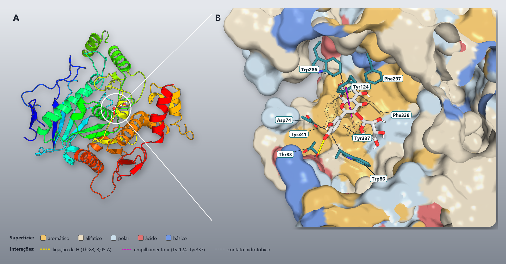
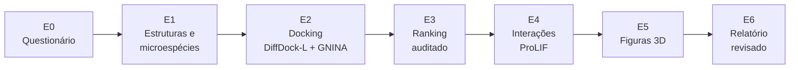
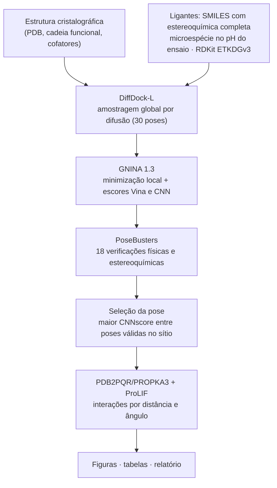
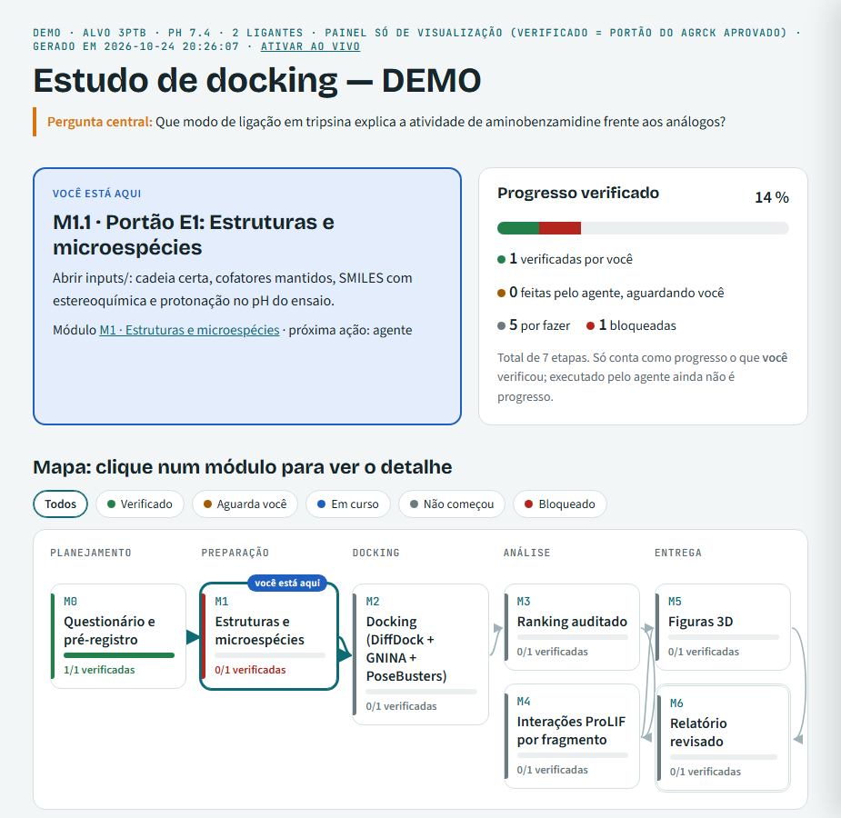

<h1 align="center">AgRCK4MolDocking</h1>

<p align="center">
  <b>Um agente de IA que conduz estudos de docking molecular do começo ao fim — com rigor científico, explicações didáticas e verificação automática em cada etapa.</b><br>
  Plugin para <b>Claude Code</b> e <b>OpenAI Codex</b> · DiffDock-L · GNINA · PoseBusters · PROPKA3 · ProLIF · PyMOL
</p>

<p align="center">
  
</p>

<p align="center"><sub>
<b>Exemplo de resultado: quercitrina na acetilcolinesterase humana (PDB 4EY6).</b>
(A) A enzima inteira, colorida do N- ao C-terminal; o círculo marca a garganta do sítio ativo, onde fica a pose selecionada.
(B) Corte da superfície do bolso, colorida por tipo de resíduo, com os resíduos que tocam o ligante. As interações foram
tipificadas pelo ProLIF no receptor protonado em pH 7,4: ligação de hidrogênio da hidroxila do catecol (anel B) com Thr83
(3,05 Å; ângulo D–H···A de 170°), empilhamento π do anel C com Tyr124 e Tyr337 e contatos hidrofóbicos com Asp74, Trp86,
Trp286, Phe297, Phe338 e Tyr341. A pose é uma hipótese estrutural do docking, não uma medida experimental.
Figura gerada pelo agente com PyMOL open-source.
</sub></p>

---

## Sumário

1. [O que é](#o-que-é)
2. [Como funciona em um minuto](#como-funciona-em-um-minuto)
3. [As sete etapas de um estudo](#as-sete-etapas-de-um-estudo)
4. [O questionário inicial](#o-questionário-inicial)
5. [A ciência por trás de cada etapa](#a-ciência-por-trás-de-cada-etapa)
6. [Como ler os resultados](#como-ler-os-resultados)
7. [Garantias de qualidade](#garantias-de-qualidade)
8. [Quem faz o quê: orquestração de modelos](#quem-faz-o-quê-orquestração-de-modelos)
9. [Memória e retomada de sessão](#memória-e-retomada-de-sessão)
10. [Painel de acompanhamento](#painel-de-acompanhamento)
11. [O relatório científico](#o-relatório-científico)
12. [Instalação](#instalação)
13. [Comandos](#comandos)
14. [Exemplo de conversa](#exemplo-de-conversa)
15. [Estrutura do repositório](#estrutura-do-repositório)
16. [Perguntas frequentes](#perguntas-frequentes)
17. [Referências e licença](#referências-e-licença)

---

## O que é

**Docking molecular** é a simulação de como uma molécula pequena, o *ligante*, se encaixa no sítio de uma proteína.
Ele responde a perguntas como:
- *"Por que este composto inibe a enzima e o análogo dele não?"*
- *"Que parte da molécula interage com qual aminoácido?"*

O AgRCK4MolDocking é um agente que roda dentro do Claude Code ou do Codex e conduz esse estudo **junto com você**:

- **Entrevista:** pergunta o que você quer estudar, com uma sugestão padrão em cada pergunta.
- **Preparo:** monta a proteína e os ligantes no estado químico correto para o pH do seu ensaio.
- **Docking e análise:** roda o docking, valida fisicamente as poses e organiza todas as métricas lado a lado.
- **Interações:** identifica cada interação e qual parte do ligante a faz.
- **Figuras:** produz figuras 3D e diagramas 2D prontos para publicação.
- **Relatório:** escreve o relatório científico (Markdown ou LaTeX/PDF), que passa por um revisor independente antes da entrega.

**O que ele não faz:** o docking gera *hipóteses estruturais*. O agente nunca apresenta um escore como afinidade
experimental e trata cada conclusão como algo a ser testado na bancada.

---

## Como funciona em um minuto



Cada etapa segue o mesmo ciclo, que se repete até a etapa estar concluída:

| Passo | O que acontece |
|---|---|
| **Preparar** | O agente lê onde o estudo parou (`progress.md`) e carrega só as instruções da etapa atual. |
| **Perguntar** | Pergunta apenas o que ainda falta decidir, sempre com uma opção recomendada. |
| **Rodar** | Executa as ferramentas científicas com os parâmetros que você aprovou. |
| **Checar** | Um **portão automático** (`agrck check`) confere a etapa: o estudo só avança se tudo estiver correto. |
| **Retornar** | Mostra o resultado em linguagem clara, atualiza o registro do estudo e espera o seu "ok". |

---

## As sete etapas de um estudo

| Etapa | O agente faz | Você decide | O portão confere |
|---|---|---|---|
| **E0 · Questionário** | Entrevista em 4 blocos e cria `estudos/<ID>/estudo.yaml` | Objetivo, alvo, ligantes, controles, pH, métrica principal | Campos completos; ligante cocristalizado presente; métrica e composto líder definidos |
| **E1 · Estruturas** | Baixa o PDB, isola a cadeia, prepara os ligantes | O estado de protonação de cada ligante no pH do ensaio | Estrutura presente; estereoquímica completa; microespécie decidida para todo grupo ionizável |
| **E2 · Docking** | DiffDock-L gera as poses; GNINA minimiza; PoseBusters valida | — | Todos os ligantes concluídos, com pose disponível localmente |
| **E3 · Ranking** | Tabela com todas as métricas e auditoria de consistência | Quais poses detalhar | Redocking ≤ 2 Å; poses no sítio; escores válidos; dependência da métrica sinalizada |
| **E4 · Interações** | Protona o receptor (PROPKA3) e tipifica as interações (ProLIF) | — | Toda interação com tipo, distância, ângulo (ligação de H) e fragmento do ligante |
| **E5 · Figuras** | Figuras 3D no PyMOL open-source e diagramas 2D | Ângulo, cores, destaque | Todos os objetos da legenda presentes; registro de cada figura |
| **E6 · Relatório** | Redige o texto; um revisor independente confere | Aprovação final | Texto sem afirmações exageradas; compilação limpa; revisão aprovada da versão atual |

Os portões formam uma cadeia: o agente **não consegue** rodar uma etapa se a anterior não passou. Se algo é refeito,
por exemplo um novo docking, as etapas que dependem dele são reabertas automaticamente.

---

## O questionário inicial

Antes de qualquer cálculo, o agente faz uma entrevista curta, em blocos de até quatro perguntas. Cada pergunta traz a
resposta recomendada. Você também pode preencher o arquivo `estudo.yaml` antes de começar.

| Bloco | Perguntas | Sugestão padrão |
|---|---|---|
| **A · Objetivo** | O que você quer saber? Para quem é o resultado? Que saída deseja? | Explicar a SAR experimental · relatório + figuras |
| **B · Alvo** | Enzima, organismo e código PDB? Cofatores, metais, resíduos-chave? pH do ensaio? | Estrutura *holo* de melhor resolução · pH 7,4 |
| **C · Ligantes** | Lista com SMILES e atividade medida. Controle positivo? Ligante cocristalizado? Qual é o mais ativo? | Incluir controles e cocristal |
| **D · Protocolo** | Quantas poses? Minimizar? Qual métrica principal? Onde rodar? Relatório em LaTeX? | 30 poses + minimização · CNNscore no sítio |

> **Por que escolher a métrica principal antes dos resultados?** Escores de docking diferentes podem ordenar a série de
> modos diferentes. Fixar a métrica antes de ver os números (**pré-registro**) impede escolher, sem perceber, a que
> favorece o composto preferido. Todas as métricas continuam sendo relatadas. Mudar a métrica depois exige uma
> *emenda* com justificativa, declarada no relatório.

---

## A ciência por trás de cada etapa



- **Por que combinar difusão e campo de força?**
  - O DiffDock-L explora a proteína inteira sem precisar de uma caixa de busca, mas pode gerar poses com choques.
  - A minimização do GNINA e o filtro do PoseBusters corrigem e descartam essas poses.
  - O resultado reúne o alcance da IA generativa e a física dos métodos clássicos.
- **Por que validar com redocking?** O ligante que já vem no cristal é docado de novo. Se o protocolo reproduz a
  posição experimental (RMSD ≤ 2 Å), há confiança para aplicá-lo aos demais compostos.
- **Por que a protonação importa?** Uma amina que no ensaio está carregada (`NH⁺`) faz pontes salinas e interações
  cátion–π que a forma neutra não faz. O agente lista os grupos ionizáveis de cada ligante e pede uma decisão
  consciente sobre cada um.

---

## Como ler os resultados

| Métrica | O que mede | Como interpretar |
|---|---|---|
| **RMSD de redocking** | Distância entre a pose prevista e a pose do cristal | ≤ 2 Å: o protocolo reproduz o experimento |
| **CNNscore** (0–1) | Confiança da rede neural de que a pose está correta | Usado para escolher a pose de cada ligante |
| **CNNaffinity** (pK) | Afinidade prevista por rede neural | Maior = mais favorável; não é medida experimental |
| **Vina** (kcal/mol) | Escore empírico de interação | Mais negativo = mais favorável; diferenças < 1 kcal/mol não discriminam |
| **LE** (kcal/mol por átomo pesado) | Escore dividido pelo tamanho da molécula | Compara moléculas pequenas e grandes de forma justa |
| **d_sítio** (Å) | Distância da pose até o centro do sítio ativo | Garante que a pose está no sítio, e não na superfície externa |

Interações são relatadas apenas quando o ProLIF as tipifica com critérios de **distância e ângulo**. Cada uma vem
acompanhada do **fragmento do ligante** responsável (por exemplo, "anel catecol" ou "ramnose"). Esse fragmento é
calculado a partir dos índices atômicos, nunca deduzido visualmente de uma figura.

---

## Garantias de qualidade

| Garantia | Como funciona |
|---|---|
| **Portões automáticos** | Cada etapa tem uma checagem determinística; sem aprovação, a próxima etapa não roda |
| **Pré-registro** | A métrica principal e o composto líder ficam congelados após o E0; mudanças viram emendas declaradas |
| **Todas as métricas, sempre** | A auditoria mostra todos os escores lado a lado e avisa quando a conclusão depende da métrica |
| **Interação com endereço** | Cada interação aponta o fragmento exato do ligante que a realiza |
| **Linguagem de hipótese** | Um verificador de texto aponta afirmações fortes demais ("comprova", "elucida") a cada edição do relatório |
| **Revisão independente** | Um revisor diferente de quem escreveu confere cada número contra as tabelas; a aprovação vale só para a versão revisada |
| **Figuras íntegras** | Figuras renderizadas com PyMOL open-source; cada figura tem registro dos objetos que contém |
| **Chave protegida** | A chave da API nunca é lida nem exibida no chat |
| **Sem loops** | No máximo duas tentativas por tarefa; depois disso, o agente mostra o que fez e pergunta como seguir |

As boas práticas que essas travas aplicam estão catalogadas em `templates/memoria/LICOES.md`. Cada item aponta o teste
automático que o garante.

---

## Quem faz o quê: orquestração de modelos

Para gastar tokens apenas onde o raciocínio científico importa, o trabalho é dividido entre papéis com modelo e esforço
fixos:

| Papel | Modelo · esforço | Responsabilidade |
|---|---|---|
| **Sessão principal** | o da sua sessão | Conversa com você, decisões e portões |
| **agrck-executor** | Haiku · baixo | Roda comandos, acompanha logs, sincroniza arquivos, compila LaTeX |
| **agrck-analista** | Sonnet · médio | Tabelas, auditoria de métricas, matriz de interações, figuras |
| **agrck-redator** | Sonnet · médio | Redação do resumo e do relatório |
| **agrck-revisor** | Opus · alto | Revisão científica independente, número por número |

O contexto carregado em toda conversa é mínimo: um `AGENTS.md` de cerca de 30 linhas. As instruções detalhadas de cada
etapa ficam em *skills* que só entram no contexto quando aquela etapa começa.

---

## Memória e retomada de sessão

| Arquivo | Para que serve |
|---|---|
| `estudos/<ID>/progress.md` | Diário do estudo: etapa atual, portões aprovados, decisões suas e histórico |
| `estudos/<ID>/estudo.yaml` | Todos os parâmetros do estudo; os comandos são montados a partir dele |
| `memoria/MEMORIA.md` | Fatos permanentes entre estudos, sempre com a fonte (arquivo ou tabela) |
| `memoria/LICOES.md` | Catálogo de boas práticas, cada uma ligada a um teste automático |

Se a conversa ficar longa ou você fechar a sessão, a próxima sessão lê o `progress.md` e continua exatamente de onde
parou, sem refazer perguntas.

---

## Painel de acompanhamento



`agrck board <ID> --open` abre um painel HTML que mostra:

- **Você está aqui:** a etapa atual e quem age a seguir;
- **Mapa do estudo:** as sete etapas e suas dependências;
- **Progresso:** quantas etapas já passaram no portão automático;
- **Como conferir:** para cada etapa, o que olhar e em qual arquivo.

O painel usa o renderizador do [specboard](https://github.com/fatioleg/specboard) e é **apenas visualização**: ele se
atualiza sozinho a cada portão e não interfere no andamento do estudo.

<br clear="right">

---

## O relatório científico

O relatório segue uma estrutura clássica e didática:

1. **Capa** — título, grupo, autores e instituição.
2. **Resumo** — contexto, objetivo, metodologia, resultados e conclusões.
3. **Sumário** e **Lista de símbolos** — siglas e grandezas físico-químicas explicadas.
4. **Introdução** — o alvo, o sítio de ligação e a tabela com as estruturas 2D de todas as moléculas.
5. **Protocolo de modelagem** — a fundamentação de cada etapa.
6. **Resultados e discussão** — redocking, métricas, modo de ligação, interações e relação estrutura–atividade.
7. **Conclusões, limitações e perspectivas.**
8. **Referências.**

O modelo LaTeX fica em `templates/report_latex/` e já sai em português, com numeração romana nas páginas iniciais.
Você preenche os dados em `General/Settings.tex`. Antes da entrega, `agrck report <ID>` verifica a compilação, as
referências cruzadas, campos ainda não preenchidos e a linguagem do texto.

---

## Instalação

**1. Ambiente científico (Linux x86_64, Python 3.12)** — passo a passo em [docs/INSTALACAO.md](docs/INSTALACAO.md):

```bash
git clone git@github.com:MPhysChem-Lab/AgRCK4MolDocking.git && cd AgRCK4MolDocking
python3 -m venv .venv && .venv/bin/pip install -r pipeline/requirements.txt
mkdir -p ~/.config/agrck && cp pipeline/.env.example ~/.config/agrck/.env   # coloque a NVIDIA_API_KEY no editor
bin/agrck doctor                                                             # confere tudo (sem exibir a chave)
```

**2. Plugin no Claude Code** — detalhes em [docs/PLUGIN_CLAUDE_CODE.md](docs/PLUGIN_CLAUDE_CODE.md):

```bash
claude plugin marketplace add MPhysChem-Lab/AgRCK4MolDocking
claude plugin install agrck4moldocking@agrck
```

**3. Plugin no Codex** — detalhes em [docs/PLUGIN_CODEX.md](docs/PLUGIN_CODEX.md):

```bash
codex plugin marketplace add git@github.com:MPhysChem-Lab/AgRCK4MolDocking.git   # depois: /plugins no Codex
```

---

## Comandos

Você normalmente conversa com o agente, e ele usa os comandos por você. Eles também podem ser rodados diretamente:

| Comando | O que faz |
|---|---|
| `agrck doctor` | Verifica o ambiente (Python, GNINA, PyMOL open-source, chave configurada) |
| `agrck new <ID>` | Cria um estudo novo em `estudos/<ID>/` |
| `agrck status` | Mostra em que etapa cada estudo está |
| `agrck check <ID> <E0…E6>` | Roda o portão automático de uma etapa |
| `agrck fetch <ID>` | Baixa a estrutura do PDB |
| `agrck dock <ID>` | Roda o docking com os parâmetros do estudo |
| `agrck audit <ID>` | Tabela de auditoria com todas as métricas |
| `agrck interactions <ID>` | Interações ProLIF de todos os ligantes, com fragmentos |
| `agrck diagram <ID> <ligante> <pose>` | Diagrama 2D de interações de uma pose |
| `agrck figure <ID> <spec.yaml>` | Figura 3D a partir de uma especificação |
| `agrck lint <arquivo>` | Verifica a linguagem científica de um texto |
| `agrck report <ID>` | Checagem final do relatório |
| `agrck board <ID> --open` | Abre o painel de acompanhamento |

---

## Exemplo de conversa

```text
Você:   Quero iniciar um novo estudo de docking.
Agente: Vamos lá. Que nome curto damos ao estudo? (sugestão: AChE_4EY6_flavonoides)
        [Bloco A — objetivo] O que você quer descobrir?
        ▸ Explicar por que um composto é mais ativo que os análogos (recomendado)
        ▸ Entender como um único composto se liga
        ▸ Triagem de muitos compostos
Você:   Explicar a SAR.
Agente: [Bloco B — alvo] Qual é a enzima e o pH do ensaio? ...
        ...
Agente: Portão E3 aprovado. O redocking da galantamina reproduziu o cristal (RMSD 0,84 Å).
        Pela métrica pré-registrada (CNNscore), a ordem é ...; pelo Vina, a ordem muda —
        os escores sozinhos não separam ativos de inativos. O que distingue o composto líder
        é a posição na garganta: ele é o único que alcança o sítio catalítico. Quer ver a figura?
```

---

## Estrutura do repositório

```
AGENTS.md                     contexto mínimo carregado em toda sessão
skills/agrck-*/SKILL.md       instruções de cada etapa (carregadas sob demanda)
agents/agrck-*.md             executor, analista, redator e revisor
hooks/                        verificações automáticas a cada ação do agente
bin/agrck                     linha de comando do agente
pipeline/                     docking, rescoring, interações, figuras e verificações (checks/)
templates/                    questionário, diário do estudo, memória e modelo LaTeX do relatório
vendor/specboard/             renderizador do painel de acompanhamento
docs/                         instalação, plugins, protocolo científico, arquitetura e orquestração
tests/  examples/3PTB/        testes automáticos (exemplo público: tripsina + benzamidina)
```

---

## Perguntas frequentes

**Preciso saber química computacional?**
Não. O agente explica cada termo na primeira vez em que aparece e sempre sugere a opção mais segura.

**Preciso de GPU?**
Não. O DiffDock-L roda pela API da NVIDIA, e o GNINA funciona em CPU, só mais devagar.

**Posso rodar os cálculos em outro computador?**
Sim. No questionário, escolha a execução via `ssh`. O agente envia o estudo ao servidor e traz os resultados de volta.

**O agente pode concluir que um composto é ativo?**
Não. Ele propõe hipóteses estruturais que explicam ou preveem resultados experimentais. A atividade é sempre medida na
bancada.

**Posso mudar de ideia sobre a métrica principal no meio do estudo?**
Pode, por meio de uma emenda com justificativa. A emenda fica registrada e aparece no relatório.

---

## Referências e licença

Corso *et al.*, DiffDock (ICLR 2023) e DiffDock-L (ICLR 2024) · Buttenschoen *et al.*, PoseBusters, *Chem. Sci.* 2024 ·
McNutt *et al.*, GNINA 1.3, *J. Cheminform.* 2025 · Bouysset & Fiorucci, ProLIF, *J. Cheminform.* 2021 ·
Olsson *et al.*, PROPKA3, *JCTC* 2011 · Riniker & Landrum, ETKDG, *JCIM* 2015 · Golden & Kiefl, Agentic PyMOL, 2026.
A lista completa está em [docs/PROTOCOLO.md](docs/PROTOCOLO.md).

Licença em [LICENSE](LICENSE). Os componentes de terceiros mantêm suas próprias licenças, e o renderizador do
specboard é Apache-2.0.
